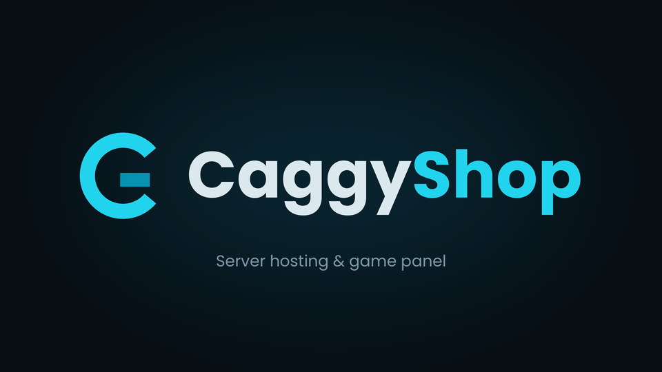

# CaggyShop - Tema Pterodactyl (Glass)



Tema cyan dengan efek **glassmorphism** dan **latar GIF anime** untuk panel Pterodactyl. Bisa dicopot kapan saja.

## Isi

| File | Fungsi |
| --- | --- |
| `caggyshop.css` | Gaya tema: kaca (blur), latar GIF, input, scrollbar, console, logo login |
| `glass.js` | Opsional. Menandai kartu panel supaya berkaca, memberi label menu navbar kiri, dan membuat widget Discord (lihat "Cara kerja") |
| `bg.gif` | Latar bawaan (sakura malam, karya orisinal). **Ganti dengan GIF anime pilihan Anda** |
| `logo-glass.png` | Logo dengan latar transparan, dipakai di halaman login |
| `caggyshop-settings/` | Halaman **Admin > Theme CaggyShop** (logo, latar, widget Discord). Dipasang otomatis oleh `install.sh` |
| `install.sh` / `uninstall.sh` | Pasang / copot tema (beserta halaman admin) |
| `logo-16x9*.png` | Logo asli (cadangan) |

## Pasang

Jalankan sebagai root di server panel:

```bash
cd caggyshop-theme
bash install.sh                  # panel di /var/www/pterodactyl
bash install.sh /path/ke/panel   # lokasi lain
```

Lalu hard refresh browser (`Ctrl+Shift+R`). Aman dijalankan ulang untuk update dari versi lama (pengaturan admin dan gambar unggahan tidak ditimpa). Lewati halaman admin dengan `NO_ADMIN=1 bash install.sh`.

## Navbar kiri

Di layar lebar (>= 769px) navbar berada di sisi kiri sebagai panel kaca melayang: logo di atas, menu **Cari / Dashboard / Admin / Akun** dengan teks, **Keluar** di dasar. Konten halaman otomatis bergeser ke kanan. Di layar kecil (<= 768px) navbar kembali ke bar atas bawaan panel (tetap berkaca) karena sidebar memakan terlalu banyak ruang di ponsel.

Lebar dan jarak diatur lewat `--cs-nav-w` dan `--cs-nav-gap` di blok `:root` `caggyshop.css`.

## Pengaturan dari Admin Panel

Menu baru **Theme CaggyShop** muncul di sidebar admin (atau buka `/admin/caggytheme`). Isinya:

| Pengaturan | Keterangan |
| --- | --- |
| Logo | Unggah file (PNG/JPG/WEBP/GIF, maks 4 MB) atau tempel link. Dipakai di navbar dan halaman login |
| Latar belakang | Unggah gambar/GIF (maks 20 MB) atau tempel link langsung ke file gambar |
| Kegelapan latar, blur kaca | Mengatur `--cs-dim` dan `--cs-blur` tanpa edit CSS |
| Widget Discord | Aktif/nonaktif, Server ID atau link widget, link undangan (opsional) |

Kosongkan dan centang **Kembalikan ke bawaan** untuk membatalkan logo/latar buatan sendiri. Setelah menyimpan, hard refresh panel (`Ctrl+Shift+R`).

Cara kerjanya: pengaturan disimpan di `public/themes/caggyshop/settings.json`, lalu `settings.css` (variabel logo/latar/blur/dim) dan `settings.js` (konfigurasi Discord) dibuat ulang setiap kali disimpan. Gambar unggahan ada di `public/themes/caggyshop/uploads/`. File-file ini tidak ditimpa saat `install.sh` dijalankan ulang. Hanya admin (root_admin) yang bisa membuka halaman pengaturan.

Batas ukuran unggahan juga mengikuti `upload_max_filesize` / `post_max_size` di php.ini. Kalau GIF latar Anda lebih besar dari itu, naikkan batasnya atau salin file langsung ke server.

## Widget Discord

1. Di Discord: **Pengaturan Server > Widget > Aktifkan widget server** (tanpa ini widget kosong).
2. Di panel: Admin > Theme CaggyShop > Widget Discord, centang tampilkan, isi Server ID (atau tempel link widget, ID diambil otomatis), simpan.

Tombol **Discord** muncul di dasar navbar kiri (tombol bulat di pojok kanan bawah pada layar kecil dan halaman login). Klik untuk membuka panel widget; tombol menampilkan jumlah anggota online. Kalau hanya mengisi link undangan tanpa Server ID, tombol langsung membuka undangan.

## Ganti latar GIF

Cara termudah: **Admin > Theme CaggyShop > Latar belakang**. Cara manual:

1. Siapkan GIF anime (disarankan 1280x720 atau lebih, di bawah ~5 MB).
2. Simpan sebagai `/var/www/pterodactyl/public/themes/caggyshop/bg.gif` (timpa file yang ada).
3. Hard refresh.

`install.sh` **tidak menimpa** `bg.gif` yang sudah Anda ganti. Pakai `FORCE_BG=1 bash install.sh` kalau ingin kembali ke GIF bawaan.

Alternatif: ubah `--cs-bg-image` di `caggyshop.css`, misalnya `url("/themes/caggyshop/nama-lain.gif")`. Untuk GIF dari internet, pakai link langsung ke file `.gif` (halaman Tenor/Giphy tidak bisa dipakai), tapi lebih aman mengunduh dan menyimpannya di server sendiri karena link luar bisa mati atau diblokir.

Pastikan Anda berhak memakai GIF tersebut, terutama jika panel dipakai untuk usaha.

## Kustomisasi

Semua di blok `:root` paling atas `caggyshop.css`:

| Variabel | Fungsi |
| --- | --- |
| `--cs-dim` | Kegelapan lapisan di atas GIF (`0`-`1`). Naikkan kalau teks sulit dibaca di GIF terang |
| `--cs-blur` | Kekuatan blur kaca (default `18px`) |
| `--cs-glass` | Warna/transparansi kartu. Turunkan alpha untuk lebih bening |
| `--cs-radius` | Kelengkungan sudut kartu |
| `--cs-cyan` | Warna aksen |

Setelah mengubah file di repo, jalankan `bash install.sh` lagi. Kalau mengubah langsung di `public/themes/caggyshop/`, cukup hard refresh.

## Cara kerja

- Menyalin file ke `public/themes/caggyshop/` dan menambahkan satu blok `<link>` + `<script defer>` sebelum `</head>` di `wrapper.blade.php` (backup: `wrapper.blade.php.caggyshop.bak`).
- Halaman admin: menambahkan `CaggyThemeController` + satu view, dua route di `routes/admin.php`, dan satu menu di `layouts/admin.blade.php` (backup: `*.caggytheme.bak`). Tidak ada migrasi database.
- Navbar kiri memakai CSS `:has()` pada elemen yang membungkus `#logo`; `glass.js` hanya menambahkan atribut `data-cs-label` (teks menu).
- Kelas CSS panel di-generate otomatis (hash), jadi tidak bisa dipilih langsung. `glass.js` hanya **membaca** warna latar elemen; kalau elemen berupa kartu gelap yang cukup besar, ia diberi atribut `data-cs-glass`, dan CSS yang membuatnya berkaca. Tidak ada rebuild frontend. Data panel tidak dikirim ke luar; satu-satunya koneksi keluar adalah widget Discord (lihat di bawah).
- Tanpa `glass.js` (hapus tag `<script>` di `wrapper.blade.php`), latar GIF, kartu login, dan input tetap berkaca; kartu dashboard kembali ke tampilan bawaan.
- File inti panel yang diubah hanya `wrapper.blade.php`, `routes/admin.php`, dan `layouts/admin.blade.php` (semuanya dengan backup, dan bisa dicopot dengan `uninstall.sh`). Database tidak diubah.
- **Privasi widget Discord:** hanya jika widget diaktifkan, browser pengguna membaca jumlah online dari `discord.com`, dan memuat iframe widget dari `discord.com` saat panel widget dibuka. Nonaktifkan di halaman admin kalau tidak mau ada koneksi ke Discord.

## Performa

GIF animasi + blur dihitung ulang tiap frame, jadi di perangkat lemah bisa terasa berat. Kalau begitu:

- pakai GIF lebih kecil/pendek, atau turunkan `--cs-blur` (mobile sudah otomatis `10px`),
- atau ganti `bg.gif` dengan gambar diam (`.jpg`/`.webp`) dan ubah `--cs-bg-image`.

Pengguna dengan pengaturan "kurangi animasi" di OS otomatis mendapat latar polos.

## Copot

```bash
bash uninstall.sh
```

Ini juga mencopot halaman admin, dan **menghapus pengaturan serta gambar yang diunggah** lewat admin (folder `public/themes/caggyshop`).

## Catatan

- Setelah `php artisan p:upgrade`, jalankan `install.sh` lagi karena `wrapper.blade.php`, `routes/admin.php`, dan `layouts/admin.blade.php` ditimpa.
- Memakai `:has()` dan `backdrop-filter`: Chrome 105+, Safari 15.4+, Firefox 121+. Browser lama jatuh ke tampilan lebih pekat.
- Ditujukan untuk Pterodactyl 1.x. Dites pada struktur folder tiruan dan halaman tiruan di Chromium; tampilan di panel asli belum diuji di semua versi, jadi kartu tertentu bisa saja tidak terdeteksi atau terlalu pekat.
- Navbar kiri dan widget Discord dites di halaman tiruan di Chromium (desktop dan lebar ponsel). Halaman admin (PHP/Blade) ditulis mengikuti pola paket `caggyshop-expiry` dan skrip pemasangnya dites pada folder panel tiruan, tetapi **belum dijalankan di panel Pterodactyl asli** (tidak ada PHP di lingkungan pembuatan). Coba di panel uji / lakukan backup dulu; bila ada error, kirim isi `storage/logs/laravel-*.log`.
